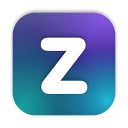
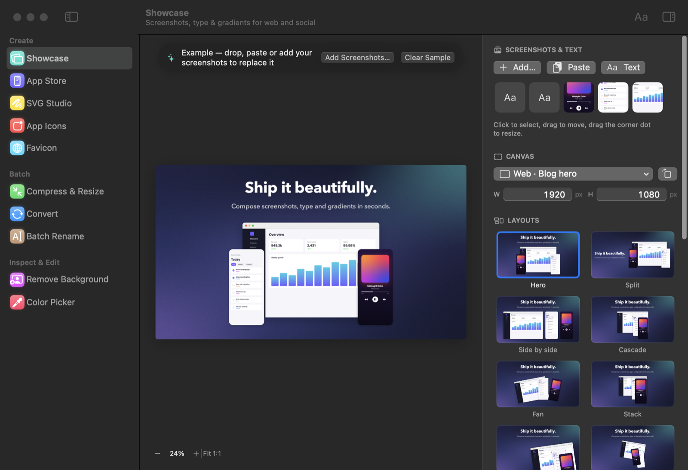
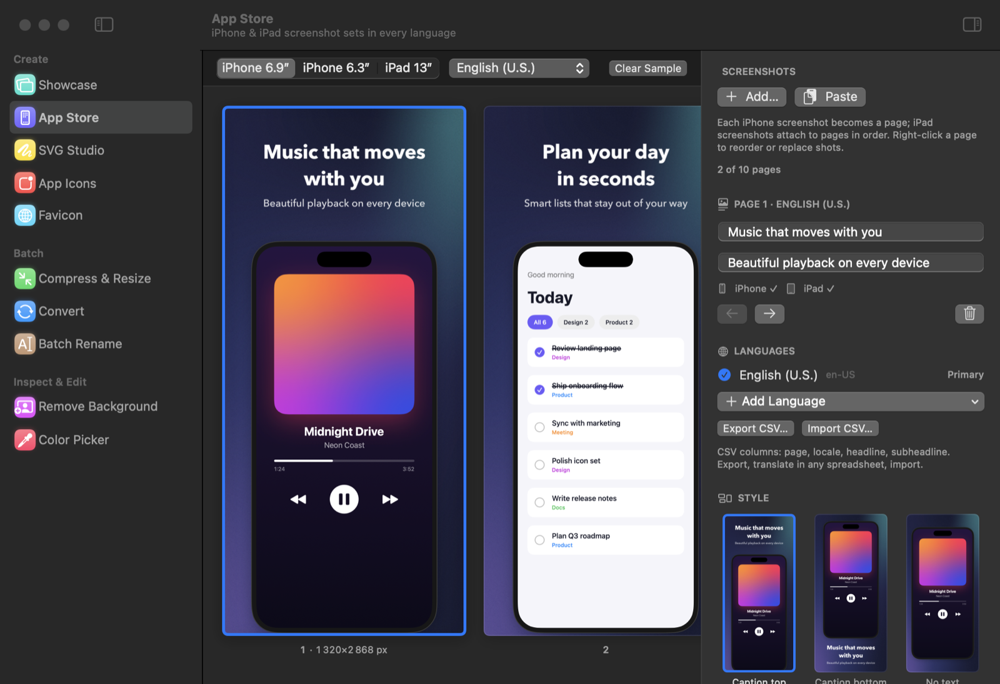
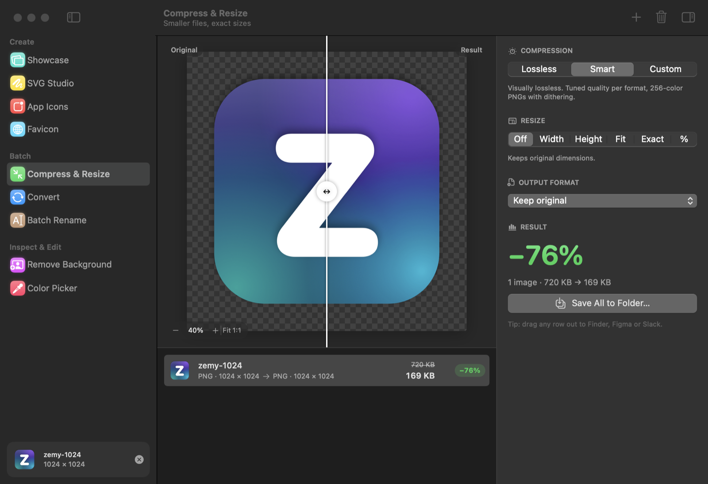
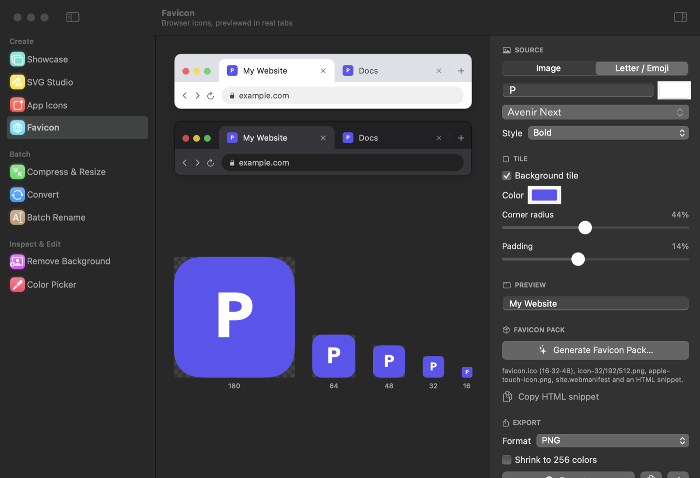

<p align="center">
  
</p>

<h1 align="center">Zemy</h1>
<p align="center"><b>The designer's swiss knife for macOS.</b><br>
Showcase screenshots, make App Store screenshot sets, compress and convert images, rename files, remove backgrounds, pick colors and make icons, all on your Mac, with nothing uploaded.</p>

<p align="center">
  <a href="../../releases/latest"><b>⬇︎ Download the latest release</b></a>
</p>



## What's inside

| | Tool | What it does |
|---|---|---|
| **Create** | **Showcase** | Drop or paste screenshots and add text, then compose them over a mesh gradient, a solid color or your own image. One-click layouts (Hero, Split, Side by side, Cascade, Fan, Stack, Bleed, Scatter) that keep text and screenshots in balance with even margins plus **your own saved layouts**. Drag, resize, rotate and reorder layers; per-image corner radius; window/browser frames; shadows. Platform sizes for Instagram, X, LinkedIn, YouTube, Open Graph, App Store and more, exported at exact pixels. |
| | **App Store** | Screenshot sets for **iPhone 6.9″, iPhone 6.3″ and iPad 13″** in 7 styles (Caption top/bottom, No text, Tilted, Duo, Panorama, Spotlight). Text and device frames are toggles. Captions per **language** (30+ App Store locales, right-to-left aware) with CSV export/import for translators. Validates the 10-per-size limit and missing shots, then exports `language/device/01.png…` at exact pixels with no alpha channel. |
| | **SVG Studio** | Paste, open or drop SVG code. Live preview, format/minify, copy as data URI or CSS, export to PNG, WebP, JPEG, PDF, ICO or ICNS at 1–8×. |
| | **App Icons** | macOS `.icns`, iOS `AppIcon.appiconset` and Android mipmaps from one image. |
| | **Favicon** | From an image or a letter/emoji on a rounded tile, previewed in real light and dark browser tabs. Exports a complete favicon pack plus the HTML snippet. |
| **Batch** | **Compress & Resize** | Lossless, visually lossless (Smart) or custom compression for PNG, JPEG, WebP, HEIC and AVIF, plus optional resizing to an exact width or height. Before/after slider. |
| | **Convert** | PNG, JPEG, WebP, HEIC, AVIF, GIF (animation kept), TIFF, PDF, ICO, ICNS, BMP, JPEG 2000. |
| | **Batch Rename** | Edit existing names (prefix, suffix, trim, find & replace, case styles) or build new ones from tokens like `{n}`, `{date}`, `{w}x{h}`. Live preview, conflict checks and Undo. |
| **Inspect & Edit** | **Remove Background** | On-device subject lift with transparent, color or blurred backgrounds, outline, shadow and crop. |
| | **Color Picker** | Sample from an image or anywhere on screen. HEX, RGB, HSL, CMYK, OKLCH, SwiftUI and Android values, tints and shades, WCAG contrast, image palettes. |



<p align="center">
  
  
</p>

## Install

1. Download **`Zemy-x.y.zip`** from the [latest release](../../releases/latest) and unzip it.
2. Drag **Zemy.app** into your **Applications** folder.
3. **First launch only:** Zemy is free and open source, and it isn't signed with a paid Apple Developer certificate, so macOS will say it *"cannot check it for malicious software"*. To open it:
   - **Right-click** (or Control-click) Zemy in Applications → **Open** → **Open**, or
   - open **System Settings → Privacy & Security**, scroll down and click **Open Anyway**.

   macOS remembers this, so you only do it once.

**Requirements:** macOS 15 Sequoia or later, Apple silicon (M1 or newer).

### Verify your download (optional)

Each release lists a SHA-256 checksum. In Terminal:

```bash
shasum -a 256 ~/Downloads/Zemy-1.1.zip
```

The result should match the checksum on the release page. Only download Zemy from this repository's Releases page.

## Privacy

- **Everything runs on your Mac.** Image processing, background removal and color extraction use Apple's on-device frameworks (Neural Engine, GPU, all CPU cores).
- **No network access:** no accounts, analytics, tracking or update checks. SVG previews run with scripts disabled and remote loading blocked.
- **Files are only touched when you ask.** Batch Rename changes names only after you click *Rename*, and you can undo it. macOS asks before Zemy can change files in Desktop, Documents or Downloads.

## Build from source

Requires Xcode (its SwiftUI macro plugin is needed; the Command Line Tools alone aren't enough).

```bash
git clone <this repository>
cd zemy
./build.sh          # → build/Zemy.app
```

The script uses Xcode's toolchain automatically. No `xcode-select` changes are needed.

### Project layout

```
Sources/Zemy/
  App.swift              tools, shared state, paste/drop routing, sidebar
  Core/Imaging.swift     decode, resize, encoders (ImageIO, libwebp, custom PNG + quantizer)
  Core/Components.swift  shared canvas, compare slider, drop zone, inspector widgets, ExportPanel
  Core/CanvasSize.swift  platform canvas presets
  Tools/*.swift          one file per tool (model + view)
Vendor/CWebP             libwebp 1.6.0 (BSD), because ImageIO can decode WebP but not encode it
Scripts/make-icon.swift  draws the app icon
```

## Contributing

Issues and pull requests are welcome. Please keep changes focused and match the surrounding code style.

## License

[MIT](LICENSE). Zemy bundles [libwebp](https://chromium.googlesource.com/webm/libwebp) under its BSD license (`Vendor/CWebP/COPYING`).
